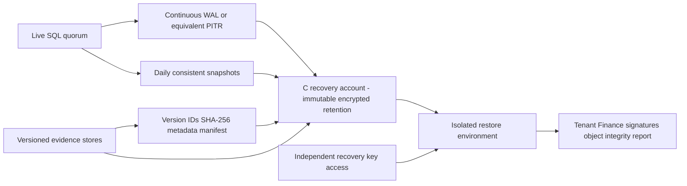

# Backup and recovery architecture

Status: PROPOSED; current provider backup/PITR settings and restores UNKNOWN_REQUIRES_VERIFICATION. Replication is not backup.

Initial proposed retention for budget/legal review: continuous PITR for 35 days, daily snapshots for 35 days, weekly for 13 weeks, monthly for 12 months. These are engineering proposals, not legal requirements or claims about the current plan. Object versions must remain at least as long as any backup that references them, including holds and rollback windows; expiry cannot strand an otherwise restorable DB snapshot. Avoid indefinite unreviewed PII retention.

C recovery account/project has separate administrators, MFA and recovery-custodian approval; production runtime has no delete/retention-reduction ability. Backup writer can append through narrow credentials; read/restore and key administration are separate. Enable provider immutable/WORM protection after testing policy on synthetic data, with encryption and access audit. Recovery depends on recoverable encryption keys, schema/migrations, image digests, IaC state and service configuration, not only SQL files. Archive auth identity mappings; actual Supabase identity backup/export/support capability must be verified with provider and privacy controls, never assume SQL application backup contains passwords/identity service state.

Monitor last successful recoverable point, log chain continuity, backup age, checksums, retention policy drift, key expiry and restore-test freshness. Proposed backup RPO <=5 minutes for logical/corruption recovery where supported; it is separate from regional acknowledged-write RPO 0. A restore to before a corrupt action intentionally rewinds history and can omit later valid ACKs; reconcile those from retained authoritative history before reopening, or record loss/impact explicitly. Do not advertise backup restore as universal RPO 0.

Weekly early-production drills restore a selected recent and periodically older snapshot into a quarantined production-security-class recovery environment; synthetic datasets for ordinary dev/staging tests. Disable outbound email/billing/webhooks and public ingress. Validate schema/constraints/migration ledger, tenant counts, per-tenant load/Finance counts and exact decimal totals, referential links, every referenced object version/checksum, signature-to-document checksums and audit continuity. Sampling alone is not proof for all restored evidence; full manifest validation is required for final drill acceptance, with incremental scans used for daily monitoring.

Report dataset size, backup ID/time, selected recovery point, start/end, measured RPO/RTO, expected/actual row/hash totals, missing objects, tool versions, operator/reviewer and retained redacted artifacts. Execute functional/tenant/idempotency regression without sending provider actions. Destroy the isolated restore only after review, recorded evidence, hold checks and explicit scoped cleanup approval. [Restore drill runbook](../runbooks/backup-restore-test.md).
