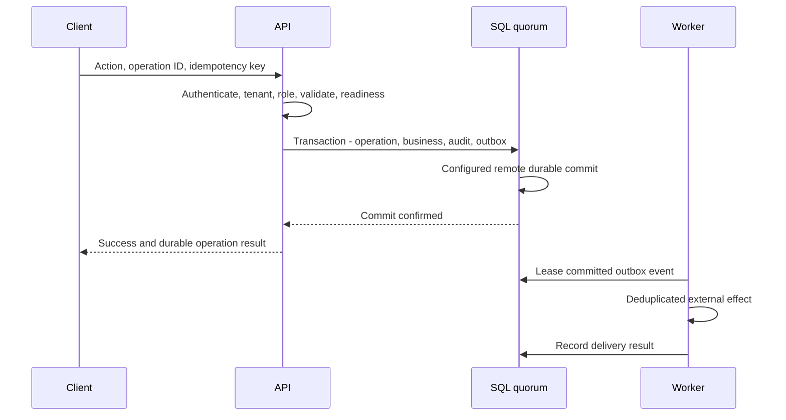

# Authoritative writes, readiness and durable events

Status: PROPOSED; current application does not implement this shared protocol.

## Write protocol

Object-dependent writes additionally need immutable two-region receipts before SQL finalization. A health check followed by asynchronous commit is not sufficient. DB permissions/settings prevent per-request durability weakening; SQL failure returns no success. Financial values use Decimal and currency, never floating-point totals. “Paid” means payment recorded durably under the existing product semantics, not bank settlement verified by LoadPacket.

## Platform state and health endpoints

All proposed endpoints live under `/api/v1/health/`; only minimal status is public, detailed reasons behind operations RBAC. `/live` means process responsive and does not query providers. `/ready` means this site can safely serve its advertised read/auth workload with compatible schema/config and current authorization dependencies. `/write-ready` means the required durability class is available, policy epoch/fencing lease valid, authoritative DB reachable and required storage receipts achievable. Worst-case global result may be 503 while safe operation classes continue; internal readiness is evaluated per action.

| State       | Reads                                  | Writes                                             | Entry / exit                                                         |
| ----------- | -------------------------------------- | -------------------------------------------------- | -------------------------------------------------------------------- |
| NORMAL      | Authorized current reads               | All qualifying classes                             | All safety gates pass                                                |
| DEGRADED    | Safe reads, reduced capacity           | Only classes still satisfying identical durability | Site/provider loss; return after stable verification                 |
| READ_ONLY   | Strong authorized reads where possible | Reject before mutation                             | Quorum/fencing/evidence safety unavailable; exit via recovery checks |
| MAINTENANCE | Explicit maintenance policy            | Fenced, no background mutation bypass              | Approved migration/cutover; exit only after checks                   |
| RECOVERING  | Restricted verified reads              | Closed until reconciliation and quorum validation  | Restore/rejoin; then controlled NORMAL/DEGRADED                      |

Policy is a durable control-plane epoch/lease enforced at APIs and workers, not a public env toggle or cache boolean. Gates include expiring health evidence; stale/unknown means deny. DB quorum remains the final race-safe authority. Mode changes are audited, authenticated and fenced; loss of the policy plane must not silently enable writes. RTO starts at externally detected loss of safe service and ends after safe synthetic acceptance, not process startup.

For a request rejected **before any mutation**, return 503, a bounded Retry-After and “LoadPacket is temporarily unable to safely save changes. No changes were accepted.” For a connection loss/timeout **after work may have committed**, use `OUTCOME_UNKNOWN`, operation ID and “We could not confirm this change. Check its status before retrying.” Do not claim rollback from a timeout. Client queries a proposed tenant/actor-scoped operation-status endpoint or retries the same key; only the committed result confirms success. A 202 response may mean “received/pending,” never “submitted.”

## Reusable idempotency

Proposed durable operation: id, organizationId, actorUserId, actionVersion, idempotencyKey, canonicalRequestHash, state, resultResourceIds, responseCode, minimal response, createdAt, expiresAt, leaseOwner/expiry and fencing token. Unique `(organizationId, actorUserId, actionVersion, idempotencyKey)`; organization-wide operations/provider events use an explicitly scoped service actor. Separate auth tenant/actor from client payload; file hash participates in upload requests. Never store bearer tokens or raw documents in result bodies.

Authenticate and authorize on every replay. Under transaction lock/unique insert, same key+hash returns prior result; same key+different hash is 409. Concurrent duplicates wait boundedly or return pending status, never run independent effects. Do not replay a previously authorized resource to an actor whose membership/assignment was revoked. Committed financial/evidence dedup tombstones survive response-body expiry and backup restoration; expiry cannot permit a second payment. Initial response retention 30 days is a proposal, with stable resource keys/tombstones retained for the business record lifetime. Validate offline retry window and privacy policy before implementation.

Statuses: IN_PROGRESS, COMMITTED, REJECTED, OUTCOME_UNKNOWN (client-facing); retryable failures do not destroy a successful record. DB-only changes can claim and finalize in one transaction. Long uploads have durable staging operations and conditional finalization. A reaper takes expired leases only after reconciliation, not by assuming failure. [Mutation inventory](mutation-audit.md) identifies adoption order.

## Transactional outbox and inbox

Outbox schema proposal: eventId, organizationId, aggregateType/id/version, type/schemaVersion, minimal payload or immutable evidence reference, occurredAt, availableAt, attemptCount, leaseOwner/leaseUntil, fencingToken, deliveredAt, lastSafeError. Business, required audit and event are atomic. Index pending availableAt and per-aggregate sequence. Workers claim with supported transactional row locks/leases, use eventId for dedup, renew leases, back off with jitter and cap poison retries into durable operator-review status. Fenced old workers cannot finalize newer claims.

Delivery is at least once. Consumer inbox unique `(consumer,eventId)` commits with its business effect; external providers get a stable idempotency key where supported. Email providers without dedup may deliver duplicates; preserve send intent and delivery uncertainty, reconcile before resending identity invitations. Never describe exactly-once email. Webhooks verify signatures/time window before durable inbox insertion; acknowledge after inbox quorum commit and process asynchronously. No webhook endpoint currently exists to migrate.

SQL polling is sufficient initially. Redis/BullMQ may later carry execution hints only; loss is repaired by scanning outbox. Observe age/attempts/dead letters, preserve aggregate ordering where necessary, and document operator replay permissions. Replaying must not duplicate payments or silently reassign ownership. Outbox/audit retention is coordinated with backups, dedup horizon and legal holds.

## Audit contract

Each critical operation records eventId, tenant, actor/role snapshot, action, resource type/id, server timestamp, operation/request/trace IDs, minimized context, prior/new state hashes where useful and versioned metadata in the same transaction. Source IP/device fields are privacy-scoped and not authority. Audit failure fails the authoritative write; telemetry export failure does not erase the durable audit. Runtime cannot UPDATE/DELETE audit; signed batch manifests and immutable recovery archive detect tampering. Hash chains alone do not stop a privileged attacker rewriting all history; separate keys/roles matter.

Required action coverage includes load creation/assignment/acceptance, stop events, uploads/signatures/reviews, payment/import/reversal, role changes, grants/revocations and controlled deletion/restoration. Finance corrections are linked adjustments/reversals; no hidden history rewrite. Durable audit exports are eventually copied to recovery; zero regional RPO comes from SQL commit, not the export schedule.
