# Deployment, environment isolation and Render migration

Status: PROPOSED. No deployment, migration, DNS, credentials, paid resources or customer data changes are authorized here.

## Build and promotion

```mermaid
flowchart LR
  PR[Reviewed PR] --> Static[Lint typecheck unit security]
  Static --> Tests[Tenant integration browser mobile tests]
  Tests --> Artifact[Build scan sign immutable digests and SBOM]
  Artifact --> Stage[Staging deploy and regression]
  Stage --> Approval[Approval and backup readiness]
  Approval --> Schema[Controlled expand migration job]
  Schema --> SiteA[Canary one site]
  SiteA --> Verify[Health integrity synthetic evidence]
  Verify --> SiteB[Remaining site same digest]
  SiteB --> Post[Post-deploy observation and reconciliation]
```

One reviewed source revision and immutable image digest per application release; deploy that same digest to A and B. Current Next Dockerfile inlines NEXT_PUBLIC values at build. Use one stable production global API/auth configuration across regions. For same-byte staging-to-production promotion, use a protected production-artifact validation environment with production public configuration and approved synthetic tenant, or first implement a reviewed runtime public-config boundary. Ordinary staging with different public build args produces a different artifact and cannot be claimed as same-artifact promotion. Until resolved, immutable cross-region promotion is possible but full build-once environment promotion remains a P0 pipeline design gate.

Separate LOCAL/DEV/STAGING/PRODUCTION resources and identities. Build jobs never receive server production secrets; runtime consumes secret manager references. Sign/scan base and app images, produce provenance/SBOM, retain prior digests and pinned lockfiles. No `latest` tags as release authority, no start-command migration/seed, no production Data API public grants. Native mobile release is separate and retains backward-compatible API versions throughout rollout.

Migration PR contains forward SQL, compatibility window, lock/time estimates and validation/repair plan. Rehearse on synthetic representative volume plus approved isolated recovery clones if necessary; snapshot/PITR/key readability must be verified before a single protected CI release job runs. Privilege expires afterwards. Expand first, deploy compatible readers/writers, backfill with checkpointed bounded jobs, verify, contract only when old clients/artifacts no longer depend on schema. Rollback application digest only while schema compatibility is proven; destructive schema rollback is not the default.

## Proposed IaC organization

`infrastructure/modules/{network,edge,compute,database,storage,secrets,observability,backups}` and `infrastructure/environments/{dev,staging,production}`. Keep recovery account resources under separately controlled state/identity. Remote encrypted locked state, reviewed plans, scoped policy checks, deletion protection and break-glass approvals. Current `infrastructure/terraform` is empty; this task adds no executable Terraform or new workflows.

## Controlled migration from Render

1. Inventory real customer data boundaries, DB/provider region, volume keys, auth identities, backup/key ownership and source digest under approved read-only operator access. Current deployment remains intact. Do not assume earlier reported health means safe replication.
2. Provision approved isolated target infrastructure and security controls only in a later ticket. Qualify database/region/object contracts before copying customer data.
3. Rehearse schema/Prisma compatibility, triggers, grants, indexes/views and migration history using real schema and synthetic data. Keep source read/write behavior unchanged until target verified.
4. Establish a consistent source snapshot plus supported CDC/log boundary if available; include all tables, Finance source bytes, audit, operation tombstones and auth mapping IDs. Cross-engine CDC must prove ordering, type fidelity, schema changes, delete/correction semantics and resume checkpoints. If unavailable, explicitly schedule a bounded write freeze for final copy; do not claim zero downtime.
5. Copy filesystem document versions/signatures/invoices/vault files to required regional stores and SHA-256 reconcile against source metadata, with recorded exact version receipts. Archive originals; missing/corrupt evidence blocks cutover. Repeat deltas while source accepts writes.
6. Shadow only authorized sanitized/read-only traffic; disable side effects, email, purchases, invitations and workers on shadow. Compare tenant projections, balances/decimal totals, counts and evidence hashes. No duplicate customer mutations.
7. Enter brief MAINTENANCE/write freeze on source, fence source workers and reject new mutation starts. Drain in-flight operations, resolve unknown outcomes, record final DB log position and upload/receipt manifest, catch target up and prove zero unresolved delta. Verify no old route can still mutate source.
8. Obtain cutover approval with independently reviewed reconciliation report and timestamp. Route global origin to target; enable one fenced authority/worker set; safe synthetic workflow then progressively reopen customer traffic. Keep old Render storage/database read-only and protected.
9. **Rollback boundary:** before target accepts writes, revert routing to still-authoritative source after reversing fences safely. After target accepts writes, source is stale: do not simply switch DNS back. Freeze target, reconcile its acknowledged delta back through a rehearsed reverse path or repair forward. If reverse replication was not validated, fail closed and recover forward; downtime is preferable to acknowledged loss.
10. Verify all tenants, critical row counts/amounts, document receipts/checksums, signature bindings, authorization, idempotency replay, outbox deliveries, alerts, backups and client version compatibility. Keep source intact for approved retention/rollback window, then require a separate decommission approval.

Near-zero downtime means pre-copy plus a measured short write freeze; no unconditional zero-downtime promise. Source volume can only be retired after full evidence reconciliation and rollback expiration, not because most files downloaded successfully. Customer communications distinguish delayed submission from accepted work. [Rollback runbook](../runbooks/bad-deployment-rollback.md).
