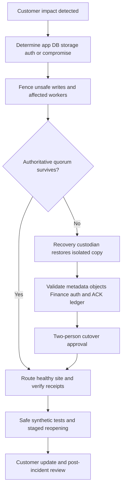

# Disaster recovery and SLO boundaries

Status: DESIGN TARGETS, NOT VERIFIED GUARANTEES.

- Acknowledged authoritative writes: RPO 0 under one regional failure with compliant SQL and object placement. Losing quorum sacrifices writes, not acknowledged data.
- Regional app/data failover: target <60 seconds from loss of safe serving to successful synthetic operation at surviving site, where quorum/storage/auth dependencies allow it.
- Full warm DR: target <15 minutes including fencing, routing, authorization, metadata/object integrity and a safe synthetic workflow. Preprovisioned capacity, credentials and restored control-plane access are prerequisites.
- Cold reconstruction/PITR: measured capacity-dependent objective, not a promised <15-minute restore of arbitrary terabytes. Estimate restore time as provisioning + bytes/verified throughput + WAL replay + integrity scan + approval/routing. If measured recovery misses the target, add warm recovery capacity or explicitly revise scope with product approval before launch.

Regional failure preserves committed state; logical corruption, credential compromise and administrative deletion require separate recovery. Independent archives may be behind live writes. Preserve evidence, identify the last trustworthy state, replay only reviewed valid changes, reconcile acknowledged operation IDs and never quietly present a rewind as complete recovery.

Incident commander owns safety/communications; DB/storage lead proves durability; security lead owns compromise scope; recovery custodian controls archives; product/support validates customer effects. Small teams may combine roles, but destructive restoration/cutover needs independent review. Contacts and paging targets must be filled and exercised in the operational system before launch; no invented on-call names.

Never force-promote a stale replica to meet a stopwatch, drop a voter to admit writes, point production at an unverified snapshot or rotate away the only recovery key. Old writer and old workers must be fenced before target becomes authoritative. If no safe authority is reachable, remain READ_ONLY/MAINTENANCE; do not fabricate access from cached entitlements/membership.

Runbooks: [regional failover](../runbooks/regional-failover.md), [database failover](../runbooks/database-failover.md), [database restore](../runbooks/database-restore.md), [incident response](../runbooks/incident-response.md), [customer recovery](../runbooks/customer-data-recovery.md). Quarterly full regional/partition drill and weekly restore drill are proposed minimums; retest after topology/schema/key changes. Record actual achieved timings and customer-safe outcomes.
