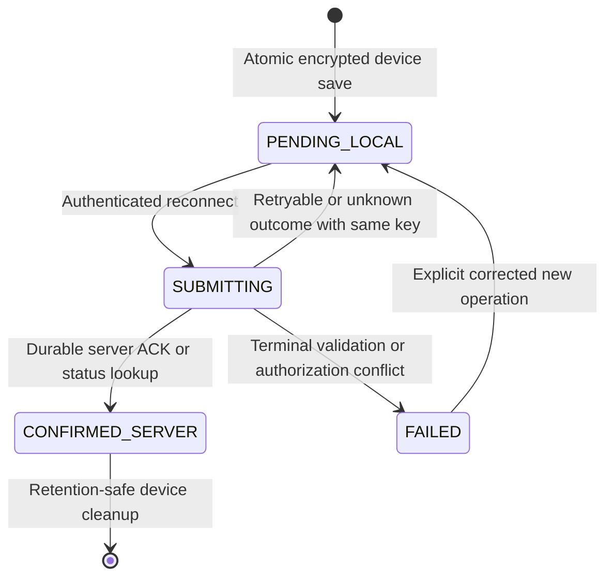

# Durable mobile offline synchronization

Status: PROPOSED. Current SecureStore session persistence and memory retry behavior are not a durable offline business queue.

Persist operation ID, server idempotency key, tenant/user/Driver identity, action/schema version, canonical payload/hash, immutable local file path/checksum, createdAt, retry count, nextAttemptAt, state, last redacted error, server resource IDs and confirmedAt. Use transactional on-device storage with encryption/key protection appropriate to the selected library; library selection and platform key lifecycle require a separate implementation ticket. Files go to app-private durable storage before queue commit, not ephemeral picker URIs. SecureStore stores keys/session, not large evidence payloads.

UI must say **Saved on this device — Not yet submitted** for PENDING_LOCAL, **Submitting** in flight, **Submitted** only after confirmed server commit, and actionable **Failed** on terminal error. Server and device timestamps remain distinct; locally captured arrival is not authoritative server acceptance or trusted GPS evidence.

Queue transitions survive process kill/reboot between file write, local commit, send and ACK. Reconcile SUBMITTING on restart using the same idempotency key/status API; never allocate a new payment/upload key because a timeout occurred. File checksum detects device corruption; missing bytes show a blocking recovery error, not silent success. Enforce quota, low-storage warnings, bounded retries with jitter and Retry-After, ordered dependent operations and explicit conflict UI for stale assignment/document versions.

Authenticate before upload; server rechecks current active assignment/role/tenant. Expired sessions pause; background sync is best effort and OS-dependent, with reliable foreground retry. Account switch isolates queues and cannot submit account A's work as B. Sign-out warns about pending work, locks its encryption namespace and requires explicit policy for keeping or deleting drafts; never silently discard it. Lost/uninstalled/destroyed device can lose unsubmitted operations: local pending is outside server RPO 0 and UI must state this limit.

Signature captures retain the exact signed DocumentVersion ID/checksum and original drawing/name/role for retry. Never replay against a later “current” version. Once final upload is confirmed, clean temporary files only after durable local confirmation and policy retention. Tests: airplane mode, intermittent networks, reboot/kill, disk full, duplicate reconnect, old build payload, account switch, lost ACK, server 503/409, revoked membership, stale signed version and checksum mismatch. See LP-PROD-011 and [test strategy](test-strategy.md).
