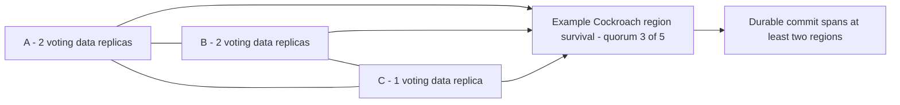

# Multi-region serving and partition behavior

Status: PROPOSED. Read [durability contract](production-principles.md) and [database evaluation](database-evaluation.md).

Sites A and B serve the same global HTTPS API/web origins using identical image digests and consistent configuration, auth issuer, private grant verification keys and schema compatibility. Each has enough warm capacity to serve the launch peak alone. Stateless requests may land in either site; retries retain idempotency keys. Workers compete using durable leases, not process-local locks. Regional caches are expendable.

Three fault domains avoid the two-site dilemma: one voter per site needs both for majority and loses write availability on either outage; allowing either isolated site to elect itself creates split brain. Add independent C votes and prove every data quorum intersects. A third control witness aids election but does not contain business data and cannot satisfy a missing data-copy requirement.

This is the Cockroach reference placement, not a universal vendor topology. Yugabyte reference is RF3 with one voting data replica in each region for every tablet and separately resilient masters: quorum 2 spans two regions. Native PostgreSQL alternative has one writer with remote synchronous durable standby plus a three-domain fencing/lease controller. C-data is inside the managed production control boundary; C-backup is a distinct account/admin domain.

## Failure matrix

| Condition                    | Traffic and reads                                                                      | Authoritative writes                                                                                                            |
| ---------------------------- | -------------------------------------------------------------------------------------- | ------------------------------------------------------------------------------------------------------------------------------- |
| A+B healthy, data healthy    | Both sites active                                                                      | Normal contract                                                                                                                 |
| A compute fails              | Edge removes A; B serves authorized strong reads                                       | Allowed only if DB and required object durability still meet policy                                                             |
| Entire A region lost         | B serves; surviving SQL quorum elects safely                                           | B+C quorum may commit; uploads require B+C verified object receipts; references with insufficient surviving copies repair first |
| A isolated from B+C          | Edge avoids A; A cannot use cached membership to authorize stale data                  | A refuses; majority side commits only with unchanged durability rules                                                           |
| C voter unavailable          | A+B may retain quorum                                                                  | Verify exact voter placement; do not reduce replication factor                                                                  |
| SQL quorum lost              | Static/help UI or explicitly safe reads only; protected resources need fresh authority | 503, no writer promotion by force                                                                                               |
| Storage quorum unavailable   | SQL-only operations may remain available if their inputs remain safe                   | Evidence mutations denied; no local-disk success fallback                                                                       |
| Edge/control provider outage | Follow provider recovery; optional preplanned alternate entry, never ad hoc unsafe DNS | Same data contract, even if traffic routing fails                                                                               |

## Routing timing and failback

Proposed global health interval 5s, three failures to remove a site, 2s probe timeout and bounded routing propagation budget. Detection + routing + client retry must be measured below 60s; DNS TTL does not bound existing connections or resolver behavior. Prefer proxy/origin routing that can switch without client DNS refresh. Do not automatically retry non-idempotent POSTs at the edge.

Use `/health/ready` for read-serving pools and `/health/write-ready` for mutation-capable paths/alerts, with in-process enforcement on all mutations. If the selected edge cannot route by method, serve reads through a healthy app and let that app deny unsafe writes; do not eject every readable site solely because global writes are unavailable. Auth, database and object failure scopes remain distinguishable.

After recovery, rejoin old DB nodes only through supported catch-up/reseed, keep app site drained, verify replication placement, synthetic read/write/replay and object checksums, observe five minutes of stable health, then restore traffic gradually. No automatic failback to a stale former writer. See [regional runbook](../runbooks/regional-failover.md).
