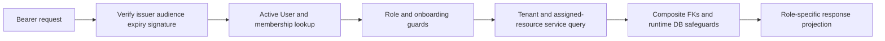

# Tenant isolation and role architecture

Status: existing safeguards PARTIALLY_IMPLEMENTED; proposed hardening requires tests and controlled migrations later. [Complete model inventory](tenant-model-inventory.md) includes every current Prisma model and relation lacking tenant-composite enforcement.

## Current boundary

Supabase JWT subject maps to one active application User with organizationId; Driver additionally requires active same-organization Driver mapping and onboarding. Current roles are OWNER, DISPATCHER, BACK_OFFICE and DRIVER. Tenant is server-derived, not accepted from request body. Global roles guard denies routes with no allowed role. Business tables are intended for Nest/Prisma access only. Existing RLS with no public policies/revocations blocks browser/mobile Data API access; it does **not** prove a privileged Prisma runtime is tenant constrained.

Identity bootstrap by verified authUserId and broker lookup by hashed grant are deliberate global indexes. After lookup, enforce active membership or exact grant scope/expiry/revocation, then tenant-scoped resource query. Background workers carry tenant from durable trusted event and use the same domain authorization rules; support identity is never customer membership by default.

## Proposed role normalization (not an existing enum change)

| Capability                               | OWNER                                                                    | ADMIN proposed                   | DISPATCHER             | ACCOUNTANT proposed         | DRIVER                      | READ_ONLY proposed                           |
| ---------------------------------------- | ------------------------------------------------------------------------ | -------------------------------- | ---------------------- | --------------------------- | --------------------------- | -------------------------------------------- |
| Company/user administration              | Yes                                                                      | Delegated, cannot grant OWNER    | No                     | No                          | Own account only            | No                                           |
| Loads/assignment                         | Yes                                                                      | Operational delegate             | Yes                    | Read                        | Assigned only               | Allowed operational projection               |
| Capture BOL/POD/signature                | Office evidence where allowed; signature capture remains assigned Driver | Same                             | Same                   | No signature capture        | Assigned workflow only      | No                                           |
| Review requirements / billing / Finance  | Yes                                                                      | Only explicit finance capability | No financial authority | Yes within finance scope    | No                          | Separate explicitly redacted read capability |
| Payroll/tax prep, Driver sensitive files | Yes                                                                      | Explicit restricted grant only   | No                     | Explicit payroll grant only | Own allowed files           | No                                           |
| Export/delete/support delegation         | Owner-confirmed, audited                                                 | Narrow delegated actions         | No                     | Scoped finance export       | Own approved export request | No                                           |

BACK_OFFICE currently covers review/Finance; migrate via explicit capability mapping, never automatically expand access by renaming it ACCOUNTANT/ADMIN. Proposed roles require product approval and negative API tests before exposure. Frontend hiding is not a control.

## Risks and safeguards

1. Older LoadAssignment, LoadStop, LoadDocument, DocumentVersion.document, LoadRequirement.load, LoadEvent, opportunities, agreements and external access relationships often reference only parent ID. Add tenant-composite constraints after auditing existing consistency; reject bad rows for manual repair, never mass-rewrite ownership. Finance and signatures provide stronger patterns already.
2. Runtime DB role may own tables or bypass RLS; verify roles externally. Target scoped transaction context via `SET LOCAL` and non-owner role, FORCE RLS where supported, policies rejecting missing tenant context, separate migration/backup roles. Pooled connections must never leak context. Identity lookup needs a narrowly granted bootstrap path; do not grant arbitrary SECURITY DEFINER queries.
3. A stolen runtime credential able to set tenant context is not fully defeated by RLS alone. Network isolation, secret control, audited support and endpoint authorization remain required.
4. File keys do not constitute authorization. Check exact document/version/tenant and Driver assignment at issue/download. Broker capabilities get explicit allowlisted document types and projections; no finance/contact/credentials leak.
5. Read replicas/caches must not authorize from stale membership, revocation or assignment. Quorum failure can make protected reads unavailable; “preserve reads” does not override security.
6. UUID opacity does not prevent IDOR. Test cross-tenant IDs in URL/body/query/nested associations, downloads/signatures/Finance exports/import references, same-tenant unassigned Driver, suspended account, role changes and replayed idempotency keys. Add direct-DB negative relation tests and pooled-context tests.

Use [security](security.md) for access administration and [LP-PROD-008](implementation-backlog.md) for acceptance. This inspection found architectural gaps; it is not a formal proof of no IDOR across every execution path.
