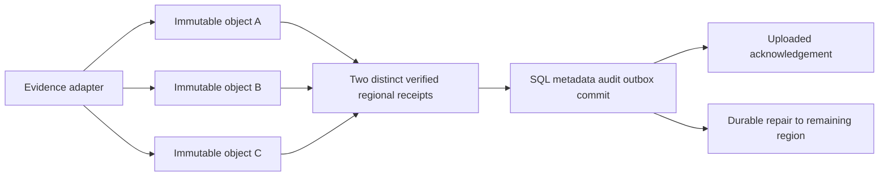
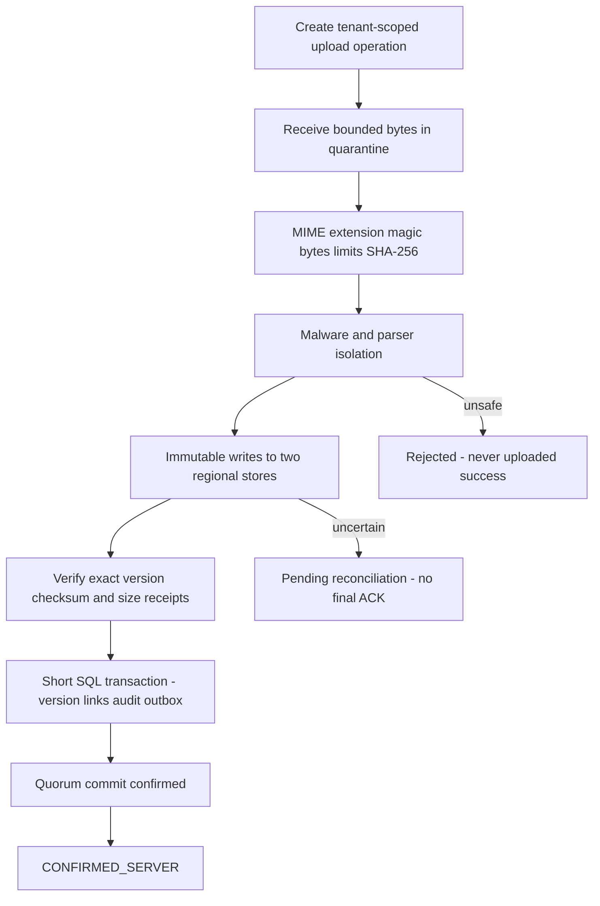

# Evidence storage and safe upload lifecycle

Status: PROPOSED. Existing LocalDocumentStorage remains unchanged in this task. Scope includes RateCon, BOL/POD, invoice, receipts, signatures, Driver evidence and company/Driver documents. Domain enums currently use CARRIER_INVOICE/LUMPER_RECEIPT/SCALE_TICKET and separate vault types; do not rename public contracts casually.

## Storage policy

Private versioned managed buckets in regions A, B and C, TLS, managed encryption with separate recovery key access, no public ACL or permanent public URL. Retain the DocumentStorage interface boundary but evolve it to return durable receipts: region/store ID, object key, provider version ID, SHA-256, byte length, MIME and retention/policy version. Opaque provider receipts belong to the storage integration mapping; business records reference immutable evidence identities.

Before authoritative upload acknowledgement, the API must verify successful immutable writes in **two distinct approved regions** and commit those receipts with metadata to SQL quorum. Default A+B; preconfigured A+C or B+C is permitted under the same two-of-three policy. Do not count two buckets in the same region. Confirm checksum by provider-supported checksum validation and exact version GET verification in POC; multipart ETag is not SHA-256. API computes authoritative checksum from validated bytes; client hash is only a comparison input.

S3 cross-region replication is asynchronous, so enabling it alone does not meet synchronous upload acknowledgement. Explicit fan-out and receipt verification is the proposed adapter protocol; background replication fills/repairs the third copy. Object Lock is per object version and requires an approved retention/deletion policy. [S3 replication](https://docs.aws.amazon.com/AmazonS3/latest/userguide/replication.html), [Object Lock](https://docs.aws.amazon.com/AmazonS3/latest/userguide/object-lock.html)

The diagram expresses two-of-three, not three mandatory writes. During outages, repair referenced objects to two reachable domains before accepting new authoritative changes that depend on their availability. Existing acknowledged data can be read from a surviving verified copy while repair proceeds. Do not claim indefinite protection against sequential permanent loss before repair.

## Upload operation

Create/upload status is explicitly pending; staging bytes alone are not an acknowledged authoritative DocumentVersion. Quarantine denied to readers and parsers until inspection passes. Validate PDF/PNG/JPEG magic bytes consistently across RateCon, Driver and vault endpoints; reject polyglot/unsupported content, excessive decoded image dimensions, ZIP/decompression bombs, parser timeout and oversized request streams. Existing limits are generally 10 MiB for documents, 5 MiB for Finance import; enforce at edge, parser and service with operation-specific budgets. Scanner outage fails completion closed; pending device copy remains available for retry.

Allocate immutable keys from server tenant/document/version/operation UUIDs. Never interpolate original filename as a path. Finalize under transaction/version preconditions and tenant-composite FKs; concurrent superseding evidence is a conflict, not an overwrite. Proposed immutable DocumentVersion stores organization/document/load link, version, exact storage receipt IDs, checksum, size, MIME, uploader and creation time. Separate mutable processing/review state from immutable original evidence.

Storage and DB cannot commit atomically. If one copy succeeds, record staging receipt and retry the same operation; do not create another document. If metadata commit is uncertain, query/reconcile before cleanup. Orphan garbage collection uses durable operation state, safety age and no committed references; legal holds/Object Lock override GC. Scanner failures and pending operations are visible, never silently removed. Avoid holding SQL row locks during large network writes.

Private downloads authorize tenant/role/assignment or scoped broker grant before issuing <=60-second exact-version retrieval. Prefer proxy retrieval for immediate revocation-sensitive Driver documents; direct presigned URLs remain bearer capabilities valid until expiry. Redact grant paths/query strings and disable shared CDN caching. Integrity mismatch quarantines that copy, tries a verified counterpart and pages operations; never substitute a different document version.

## Signature and Finance evidence

Preserve the existing exact document-version signature FK. Add documentVersionChecksum snapshot to signature evidence plus signer name/role, actor, signedAt, signature checksum and immutable receipt references. Verify captured version checksum equals the referenced immutable original, not “current version.” Existing signature UPDATE trigger is useful; controlled delete/retention permissions and immutable version metadata still need implementation. Corrections supersede or append evidence; do not rerender the original PDF and pretend it was signed. No claim of legal electronic-signature enforceability without counsel.

Finance import original bytes currently live in SQL. Preserve them during migration; do not silently move/delete provenance. If moved later, use the same evidence lifecycle with exact batch/checksum mapping. No parser/extraction result becomes authoritative financial information without explicit confirmation.

## Migration and acceptance

Enumerate all committed DocumentVersion and signature storage keys, including invoices and vault documents. Take a consistent metadata boundary, copy bytes to private target stores, verify SHA-256/size/exact mapping in each required region, record missing/corrupt sources as blockers. Never silently regenerate missing signed evidence. Repeat delta copy; fence writes for final reconciliation; switch adapter/config only after all committed references satisfy policy. Retain legacy mount read-only through rollback window and legal retention. Full cutover protocol is in [deployment](deployment.md). Test partial upload, scanner failure, wrong checksum, one/two region outages, DB commit uncertainty, retries, stale versions, grant revocation and restore before launch.
