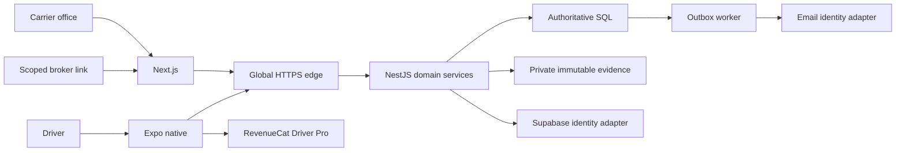
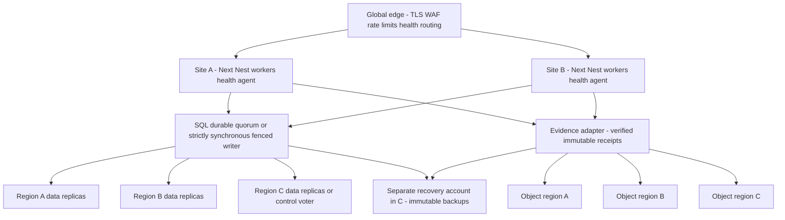

# Production architecture

Status: PROPOSED — REQUIRES POC AND OPERATIONAL ACCEPTANCE. No infrastructure execution is authorized by LP-PROD-01. Start with [current-state audit](current-state-audit.md), [principles](production-principles.md), [roadmap](production-roadmap.md), and [release gates](release-gates.md).

Preserve the modular NestJS monolith, Next.js web, Expo Driver, Prisma/SQL and provider adapters. Introduce only capabilities required to prevent customer-data loss. The existing Render application is CURRENT / LEGACY PRODUCTION-REFERENCE OR STAGING CANDIDATE; do not repurpose or destroy it while it has customer data.

## System context

## Proposed deployment

SQL choice remains gated by [database evaluation](database-evaluation.md). The reference distributed deployment spans three regions; native PostgreSQL fallback uses one writer, synchronous remote data standbys and an independent consensus/fencing control plane. Active-active application serving does not mean unconstrained independent database writers. Region C voting data and C backup administration are separate security boundaries. An empty witness cannot substitute for a durable copy.

Evidence adapter requires two verified regional object copies among three configured stores before metadata commit. Usually A+B; A+C or B+C is the same preapproved two-region policy, not a durability downgrade. Replication/repair fills the third copy. A region outage may preserve SQL writes yet block uploads if only one object domain is usable. Metadata and objects are reconciled without a cross-service distributed transaction; see [object storage](object-storage.md).

## Component justification and small-team operation

- Managed regional container runtime: independent A/B serving and rolling replacement, without operating Kubernetes. Reference option is AWS ECS/Fargate plus regional load balancers; this is a candidate, not a provisioned or priced selection. A managed PaaS qualifies only with verified region independence, networking, probes, secrets and controlled deployment.
- Global managed edge: automated site removal, WAF/DDoS controls and per-tenant quotas. Candidate Cloudflare Load Balancing; qualify health and origin failover semantics in staging, with no manual DNS change during incidents.
- Managed SQL: authoritative ACID transactions and cross-region durable acknowledgements. Ordinary regional HA plus asynchronous DR does not qualify. Vendor support and actual failover behavior are procurement gates.
- Private regional object stores: remove single-volume evidence loss. Three stores and two-copy commit policy add reconciliation work; use the existing adapter boundary and managed storage, not a filesystem cluster.
- Database outbox and worker process from the same codebase: durable retries for email/processing. Poll SQL first; no Redis/BullMQ until throughput justifies it. `apps/worker` is presently empty, not an existing deployed service.
- Cache: optional local bounded metadata/performance cache; cold-cache operation must be correct. No Redis required initially. Private document bytes and authorization decisions are not globally cached. SQL search and bounded SQL reports remain sufficient until measured otherwise.
- Managed telemetry and backup retention: prevents silent loss and unrecoverable incidents. Account isolation, key recovery and weekly drills impose necessary operational work.

The exact provider, geography, data-residency policy, region RTT, service plan/quotas and budget remain decisions for LP-PROD-001/002. No claim of purchased services, configured replication, uptime SLA or completed production penetration testing is made.

## Guarantees and dependencies

Application failover target is under 60 seconds; warm complete DR target is under 15 minutes where measured achievable. Both are objectives, not present guarantees. Cold restore of large datasets may exceed 15 minutes. Auth outage may block fresh login even when app sites are healthy. RevenueCat outage locks paid Finder capability, not free POD workflows. Email outage retains pending durable intent, not a fictitious delivered status.

Organization SaaS billing is a future server-side `OrganizationBillingProvider` interface (customer, plan, checkout intent, webhook verification, reconciliation); it is independent of mobile Driver Pro and must not gate core logistics. No general ledger, payroll execution, tax filing, warehouse, Kafka, Kubernetes or search cluster is introduced.

Operational detail: [multi-region](multi-region.md), [security](security.md), [observability](observability.md), [deployment and migration](deployment.md), [capacity](capacity-planning.md), [cost model](production-cost-model.md), [test strategy](test-strategy.md). All designs in this package require implementation and evidence before customer launch.
